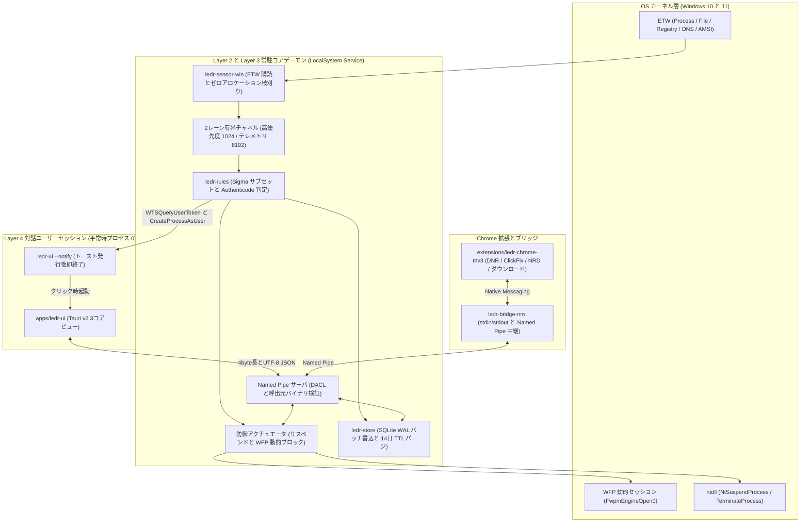
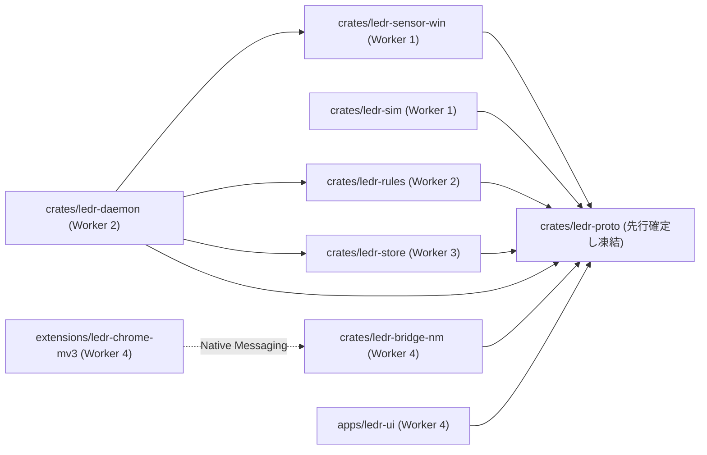

状態: 進行中

# LocalEDR 実装計画書

## 概要と確定済み仕様決定の参照

本計画書は [ledr_artifact.html](../ledr_artifact.html) に記載された個人向け軽量エンドポイントセキュリティ（以下「LocalEDR」と呼ぶ）の設計方針について、Windows カーネル API の制約やレイヤー間の未定義箇所を整理したうえで、確定仕様と段階的な実装手順をまとめたものである。

[ledr_artifact.html](../ledr_artifact.html) は、全ファイル走査型の従来型アンチウイルスや常駐型 Electron GUI を排し、OS カーネルのイベント駆動通知、Rust 製常駐コアデーモン、組み込み SQLite WAL ストア、オンデマンド起動の Tauri v2 UI、および Chrome Manifest V3 拡張機能の連携によって CPU 負荷 1% 未満と常駐メモリ 10〜20 MB 以下の両立を目指している。

設計レビューで抽出した要協議事項 A〜P は 2026-11-18 に、Phase 4 詳細設計の追加論点 5 件は 2026-11-21 に、性能改善 `FU-E2E-03` の追加論点 3 件および IPC 呼び出し元認可の統一 1 件は 2026-11-23 にユーザーが全推奨案を承認して確定した。
確定した 25 件の仕様判断は [decision-records.md](decision-records.md) に保存しており、本計画書では決定内容や根拠を重複管理せず `決定記録 L-01` 〜 `決定記録 L-25` の ID で参照する。

| 決定 ID | 論点 | 計画書内の主な反映先 |
| :--- | :--- | :--- |
| `決定記録 L-01` | ターゲット OS の初期実装範囲 | 前提と実行環境、ワークスペース共通定義 |
| `決定記録 L-02` | 機密ファイル保護の位置づけ | Layer 1 詳細設計 |
| `決定記録 L-03` | WFP アウトバウンド制御と承認方式 | Layer 1 詳細設計、Layer 2 詳細設計 |
| `決定記録 L-04` | ホワイトリストと許可ルールの識別基準 | Layer 2 詳細設計、Layer 3 詳細設計 |
| `決定記録 L-05` | Folder Canary の対象パス指定モデル | Layer 1 詳細設計 |
| `決定記録 L-06` | おとりファイル設計と削除管理 | Layer 1 詳細設計、Layer 3 詳細設計 |
| `決定記録 L-07` | サスペンド範囲と 60 秒未応答時の状態遷移 | Layer 1 詳細設計、Layer 2 詳細設計、Layer 4 詳細設計 |
| `決定記録 L-08` | Session 0 からの通知と UI 起動方式 | Layer 2 詳細設計、Layer 4 詳細設計 |
| `決定記録 L-09` | Named Pipe IPC の認可と偽装防止 | ワークスペース共通定義、Layer 2 詳細設計 |
| `決定記録 L-10` | 有界バッファ上限とドロップ規約 | Layer 2 詳細設計 |
| `決定記録 L-11` | SQLite TTL と親プロセス孤児化防止 | Layer 3 詳細設計 |
| `決定記録 L-12` | 軽量 Sigma サブセット範囲 | Layer 2 詳細設計 |
| `決定記録 L-13` | 3 つのコアビューと 5 秒隔離手順 | Layer 4 詳細設計 |
| `決定記録 L-14` | NRD とホモグラフ判定のデータソース | Layer 2 詳細設計、Layer 4 詳細設計 |
| `決定記録 L-15` | Pastejacking と ClickFix の発火条件 | Layer 4 詳細設計 |
| `決定記録 L-16` | Windows Service 復旧と自己保護方針 | 前提と実行環境、Layer 2 詳細設計 |
| `決定記録 L-17` | Phase 4 の PR 分割方針と実機 Chrome E2E 検証の切り分け | 段階的実装計画（Phase 4）、`FU-E2E-02` |
| `決定記録 L-18` | 移動後 MOTW バイナリの事前 WFP 制限 | Layer 2 詳細設計（`ProcessStart` MOTW 評価） |
| `決定記録 L-19` | `ReportBrowserEvent` 受信時の OS トースト通知要否 | Layer 2 詳細設計、Layer 4 詳細設計 |
| `決定記録 L-20` | 拡張機能の固定公開鍵と `ledr-bridge-nm setup` スコープ | Layer 4 詳細設計（Native Messaging） |
| `決定記録 L-21` | ClickFix 観測用 `MAIN` world フックと DNR 初期ルール範囲 | Layer 4 詳細設計（Chrome MV3 拡張） |
| `決定記録 L-22` | `AUTO-09` 読取専用 SQLite 接続の `cache_size` 縮小とアイドル時解放 | Layer 2 詳細設計、Layer 3 詳細設計 |
| `決定記録 L-23` | Authenticode 署名検証の専用ワーカー分離とフェイルクローズ | Layer 1〜3 詳細設計（署名検証経路） |
| `決定記録 L-24` | `E2E-PERF-01` 定常メモリ基準への `PrivateWorkingSetSize` 併記 | 前提と実行環境、実機検証（Track C） |
| `決定記録 L-25` | 全 IPC コマンドへの呼び出し元バイナリ認可統一（`Ping` 除外） | Layer 2 詳細設計、Layer 4 詳細設計 |

技術的な品質と安全性を確保するための改善 15 項目（`AUTO-01` 〜 `AUTO-15`）は、仕様の意図を変えない範囲で各層の設計へ織り込んでいる。

| 項目 ID | 対象層 | 適用内容 |
| :--- | :--- | :--- |
| `AUTO-01` | Layer 1〜3 | PID 再利用を防ぐため、起動時刻と PID の複合識別子（`ProcessIdentity` および `process_instance_id`）を導入する |
| `AUTO-02` | Layer 1 | `csrss.exe`、`lsass.exe`、`dwm.exe`、`explorer.exe`、および LocalEDR 自身を除外するサスペンド禁止リストを実装する |
| `AUTO-03` | Layer 1 | 起動時に `CreateToolhelp32Snapshot` で既存プロセスを取得し、`NtSuspendProcess` 実行直前に `CreationTime` 一致を検証する |
| `AUTO-04` | Layer 1 | WFP セッションへ `FWPM_SESSION_FLAG_DYNAMIC` を指定し、デーモン異常終了時の通信不能を防ぐ |
| `AUTO-05` | Layer 1 | `DNS-Client` イベントと `Kernel-Network` 接続を結ぶインメモリ LRU キャッシュ（`DnsResolutionCache`）を実装する |
| `AUTO-06` | Layer 1 | AMSI 検査を DLL 注入ではなく ETW（AMSI イベント ID 1101 と PowerShell イベント ID 4104）の非同期購読へ統一する |
| `AUTO-07` | 文書整合 | [L406](../ledr_artifact.html#L406) の Linux `XDP` 表記を [L552](../ledr_artifact.html#L552) と揃えて `eBPF Cgroup SockAddr / Socket Filter` 相当として整理する |
| `AUTO-08` | Layer 1〜2 | `QueryDosDeviceW` ボリューム変換表と UTF-16 スライス比較により、対象外の `FileIo` イベントをメモリ確保前に破棄する |
| `AUTO-09` | Layer 3 | SQLite 接続へ `mmap_size = 0`、`wal_autocheckpoint = 1000`、および接続別 `cache_size`（書込専用 1 接続は `-2048`、読取専用接続は `-512`）を強制し、停止未要求かつ 30 秒以上無アクセス時は 60 秒定期保守ティックから `shrink_reader_memory_if_idle(30s)`（`PRAGMA shrink_memory`）を実行する |
| `AUTO-10` | Layer 2〜3 | サービス停止シグナル受信時に 3 秒以内でチャネルの残件フラッシュと `wal_checkpoint(TRUNCATE)` を行う終了処理を実装する |
| `AUTO-11` | Layer 4 | Native Messaging と Named Pipe（`\\.\pipe\localedr-ipc`）を中継するブリッジ CLI（`ledr-bridge-nm`）を設け、4 バイト長と UTF-8 JSON に統一する |
| `AUTO-12` | Layer 4 | 拡張の `downloads.onCreated` と `onChanged` 完了フックを組み合わせ、デーモン側で SHA-256 算出と `:Zone.Identifier` 確認を行う |
| `AUTO-13` | Layer 1 | デーモン初期化時に `SeSystemProfilePrivilege`、`SeDebugPrivilege`、`SeSecurityPrivilege` を有効化する |
| `AUTO-14` | Layer 4 | 拡張機能の公開鍵固定で ID を確定し、初期設定処理で Native Messaging レジストリと `ledr://` URI スキームを自動登録する |
| `AUTO-15` | 全体 | 無害な疑似攻撃シミュレータ（`ledr-sim`）と毎秒 10,000 イベントのバースト負荷ベンチマークをテスト計画へ組み込む |

## 前提と実行環境

初期実装の対象環境は Windows 10 および Windows 11（x86_64）専用とする（`決定記録 L-01`）。
[L519–575](../ledr_artifact.html#L519-L575) には Linux と macOS も並列に書かれているが、個人開発規模で 3 OS の特権 API を同時実装すると検証負荷が発散し、macOS の EndpointSecurity は Apple の Entitlement 審査が配布の障壁になる。
将来 Linux の Aya eBPF へ拡張できるよう、Layer 1 と Layer 2 を結ぶ抽象トレイトを `crates/ledr-proto` に切り出しておく。

カーネルドライバ（`.sys` ミニフィルタドライバや WFP Callout ドライバ、ELAM、PPL）は書かず、OS 標準のユーザースペース特権 API のみで構築する（`決定記録 L-02`、`決定記録 L-03`）。
コアデーモンは `LocalSystem` 権限の Windows Service として稼働させ、SCM 回復オプション（失敗時 1 秒後に自動再起動）を設定したうえで、設定、ルール、SQLite DB を `SYSTEM` と管理者のみ書込可能な DACL を持つ `C:\ProgramData\LocalEDR\` へ格納する（`決定記録 L-16`）。

結合テストおよび実機検証のうち ETW、WFP、Named Pipe DACL、`NtSuspendProcess`、`CreateProcessAsUser` を伴う確認は、Windows 10 または Windows 11（x86_64）の管理者昇格セッションが必須となる。
一方、`ledr-proto`、`ledr-rules`、`ledr-store` のロジック単体テストは非特権環境でも実行できる。

目標性能は以下の数値を基準として維持する（`決定記録 L-24`）。

- デーモンの常駐メモリは `PrivateWorkingSetSize <= 20.0 MB` を必須基準とし、`WorkingSet64` は Windows 11 OS 共有ページ（`Shared == 1`、下限約 14.5 MB）を含む参考値およびスパイクと単調増加の監視基準（600 秒定常後半前半中央値差 `<= +1.0 MB`、`>= 100.0 MB` スパイク 0 回、高負荷ピーク `< 64.34 MB`）として併記する。
- アイドル定常時の CPU 平均使用率は 0.5% 未満、バーストおよび高負荷時は 1% 未満に抑える。
- オンデマンド UI はウィンドウ閉鎖時に完全終了させ、待機中のプロセス数とメモリ使用量を 0 に保つ。

## 設計レビュー課題の解決方針

[ledr_artifact.html](../ledr_artifact.html) を技術的に精査した際に抽出された抜け漏れや矛盾は、次の確定方針によってすべて解消した。

1. モデル上の不足は`ProcessIdentity` 複合識別子（`AUTO-01`、[L405](../ledr_artifact.html#L405)、[L623](../ledr_artifact.html#L623)）、SQLite 7 テーブルとインデックス定義（`AUTO-09`、[L442](../ledr_artifact.html#L442)）、署名済みと未署名の 2 階層許可モデル（`決定記録 L-04`、[L393](../ledr_artifact.html#L393)、[L631](../ledr_artifact.html#L631)）、Folder Canary パス（`決定記録 L-05`、[L392](../ledr_artifact.html#L392)）、おとりファイル管理（`決定記録 L-06`、[L411](../ledr_artifact.html#L411)）、アラート 6 状態遷移（`決定記録 L-07`）、WFP 動的セッションと DNS 相関キャッシュ（`AUTO-04`、`AUTO-05`）、および 4 バイト長フレーミングと 3 段階ダウンロード紐付け（`AUTO-11`、`AUTO-12`、[L448](../ledr_artifact.html#L448)、[L600](../ledr_artifact.html#L600)）で補完した。
2. 未定義だった運用規則はシステム重要プロセスのサスペンド禁止リスト（`AUTO-02`、`AUTO-03`）、2 レーン有界チャネル（`決定記録 L-10`）、14 日 TTL パージと親プロセス孤児化防止（`決定記録 L-11`、[L442](../ledr_artifact.html#L442)）、Named Pipe DACL と呼出元バイナリ検証（`決定記録 L-09`）、日次ローカル NRD フィード（`決定記録 L-14`、[L405](../ledr_artifact.html#L405)、[L594](../ledr_artifact.html#L594)）、ClickFix 誤検知抑制ルール（`決定記録 L-15`、[L594](../ledr_artifact.html#L594)）、および 3 つのコアビューと 5 秒隔離手順（`決定記録 L-13`、[L615](../ledr_artifact.html#L615)）として定義した。
3. 仕様の矛盾や曖昧さは、ETW `FileIo` の非同期事後通知を前提とした読み取り直後凍結と通信遮断の併用（`決定記録 L-02`、[L393–394](../ledr_artifact.html#L393-L394)）、WFP ユーザースペース API における事前ブロックと初発通信時サスペンドのハイブリッド制御（`決定記録 L-03`、[L405–406](../ledr_artifact.html#L405-L406)、[L548](../ledr_artifact.html#L548)）、AMSI の ETW 購読統一（`AUTO-06`、[L400](../ledr_artifact.html#L400)、[L562](../ledr_artifact.html#L562)）、Session 0 隔離下での `CreateProcessAsUser` ワンショット通知起動（`決定記録 L-08`、[L436](../ledr_artifact.html#L436)、[L448](../ledr_artifact.html#L448)）、`downloads.onChanged` 完了フックとブリッジ CLI 導入（`AUTO-11`、`AUTO-12`、[L600](../ledr_artifact.html#L600)）、および Aho-Corasick による Sigma サブセット制約（`決定記録 L-12`）へ改めた。
4. 非機能面の不足は`SeDebugPrivilege` 等の特権有効化（`AUTO-13`）、SCM 自動再起動と ACL 保護（`決定記録 L-16`）、拡張 ID 固定とレジストリ自動登録（`AUTO-14`）、および疑似攻撃シミュレータ `ledr-sim` と負荷テスト（`AUTO-15`）を計画に組み込んで補った。

なお、主要ブラウザや開発ツールが自動更新によりバイナリハッシュを頻繁に変えるという前提は運用上の推測に基づくため、未署名バイナリ向けの厳格なハッシュ一致を維持しつつ、署名済みバイナリに限り Authenticode 署名許可を選択できる構成を採っている（`決定記録 L-04`）。

## システム構成と排他ワークスペース境界

並列実装で複数ワーカーが同じファイルを編集して競合する事態を避けるため、共有型とトレイトを配置する `crates/ledr-proto` を Phase 0 で確定して凍結し、各層が自分の担当ディレクトリのみを所有する DAG 構造とする。





ワーカー間のファイル排他境界は次のディレクトリ構成で管理する。

```text
LocalEDR/
├── Cargo.toml                  # ワークスペース共通定義 (Phase 0 で凍結)
├── docs/
│   ├── decision-records.md     # 確定仕様決定記録 L-01 〜 L-25
│   ├── follow-up-notes.md      # 副次申し送り事項と実機 E2E 検証記録
│   └── implementation-plan.md  # 本実装計画書
├── crates/
│   ├── ledr-proto/             # 共通型、IPC メッセージ、トレイト定義 (Phase 0 で凍結)
│   ├── ledr-sensor-win/        # Worker 1: ETW, WFP, AMSI, サスペンド, おとりファイル
│   ├── ledr-sim/               # Worker 1: 無害な疑似攻撃シミュレータ CLI
│   ├── ledr-rules/             # Worker 2: 早期枝刈り, Sigma 評価, Authenticode, NRD 照合
│   ├── ledr-daemon/            # Worker 2: LocalSystem サービス, 2レーンパイプライン, IPC サーバ
│   ├── ledr-store/             # Worker 3: SQLite WAL ストア, バッチ書込, TTL パージ
│   └── ledr-bridge-nm/         # Worker 4: Native Messaging と Named Pipe の中継 CLI
├── apps/
│   └── ledr-ui/                # Worker 4: Tauri v2 オンデマンド UI とトースト通知モード
├── extensions/
│   └── ledr-chrome-mv3/        # Worker 4: Chrome 拡張機能 (Manifest V3)
└── rules/                      # Worker 2: 初期 Sigma ルール群と標準 OS 許可リスト
```

## 共通型定義と層別詳細設計

### ワークスペース共通定義と共有型

ルートの `Cargo.toml` は Rust 2024 エディション（または安定版 2021）の Cargo Workspace として全クレートを束ね、`[workspace.dependencies]` に `windows`、`ferrisetw`、`rusqlite`、`tokio`、`serde`、`serde_json`、`aho-corasick`、`sha2`、`uuid` 等のバージョンを集約する。
外部クレートを追加する際は、MIT や Apache-2.0 など許容されるライセンスであることを事前に確認する。

`crates/ledr-proto` は共有データ型、Layer 1 と Layer 2 を結ぶ抽象トレイト（`決定記録 L-01`）、および Named Pipe IPC のメッセージ型のみを配置する。
IPC パイプ名は `\\.\pipe\localedr-ipc` に固定し、フレーミングは 4 バイトのリトルエンディアン符号なし 32 ビット長（上限 1 MiB）に続く UTF-8 JSON として Chrome Native Messaging の標準入出力プロトコルと揃える（`決定記録 L-09`、`AUTO-11`）。

```rust
/// PID 再利用を防ぐプロセス一意識別子
#[derive(Debug, Clone, PartialEq, Eq, Hash, Serialize, Deserialize)]
pub struct ProcessIdentity {
    pub pid: u32,
    pub create_time_100ns: u64,
}

/// 保護対象カテゴリ
#[derive(Debug, Clone, Copy, PartialEq, Eq, Serialize, Deserialize)]
pub enum CanaryCategory {
    CookieDb,
    LoginData,
    SshKey,
    CloudCredential,
    EnvFile,
    Honeypot,
    AutorunRegistry,
}

/// スクリプト評価ソース
#[derive(Debug, Clone, Copy, PartialEq, Eq, Serialize, Deserialize)]
pub enum ScriptSource {
    Amsi,
    PowerShell4104,
}

/// Layer 1 から Layer 2 へ送出される正規化センサーイベント
#[derive(Debug, Clone, Serialize, Deserialize)]
pub enum SensorEvent {
    ProcessStart {
        identity: ProcessIdentity,
        parent_pid: u32,
        exe_path: String,
        command_line: String,
        user_sid: Option<String>,
    },
    ProcessStop {
        pid: u32,
        exit_time_100ns: u64,
        exit_code: u32,
    },
    DnsQuery {
        pid: u32,
        query_name: String,
        query_type: u16,
        resolved_ips: Vec<std::net::IpAddr>,
        timestamp_ms: i64,
    },
    NetworkConnect {
        pid: u32,
        protocol: u8,
        dst_ip: std::net::IpAddr,
        dst_port: u16,
        domain_hint: Option<String>,
        timestamp_ms: i64,
    },
    CanaryFileAccess {
        pid: u32,
        target_path: String,
        category: CanaryCategory,
        access_mask: u32,
        is_write_or_delete: bool,
        timestamp_ms: i64,
    },
    ScriptEvaluated {
        pid: u32,
        source: ScriptSource,
        script_content: String,
        timestamp_ms: i64,
    },
}

/// アラート状態遷移
#[derive(Debug, Clone, Copy, PartialEq, Eq, Serialize, Deserialize)]
pub enum AlertStatus {
    Pending,
    ExpiredSuspended,
    ApprovedOnce,
    ApprovedRule,
    TerminatedBlocked,
    Dismissed,
}

/// ユーザー操作によるアラート解決アクション
#[derive(Debug, Clone, Serialize, Deserialize)]
pub enum AlertDecision {
    AllowOnce,
    AllowPermanent {
        use_signer_if_available: bool,
        allow_dest: Option<String>,
    },
    TerminateAndBlock {
        add_block_rule: bool,
    },
}

/// Layer 2 から Layer 1 アクチュエータを呼び出す抽象境界
pub trait ActiveDefenseController: Send + Sync {
    fn suspend_process(&self, target: &ProcessIdentity, include_children: bool) -> Result<(), String>;
    fn resume_process(&self, target: &ProcessIdentity) -> Result<(), String>;
    fn terminate_process(&self, target: &ProcessIdentity, include_children: bool) -> Result<(), String>;
    fn add_wfp_app_rule(&self, exe_path: &std::path::Path, remote_ip: Option<std::net::IpAddr>, allow: bool) -> Result<u64, String>;
    fn remove_wfp_rule(&self, filter_id: u64) -> Result<(), String>;
}
```

### Layer 1 カーネルセンサーと疑似攻撃シミュレータ

Worker 1 が担当する `crates/ledr-sensor-win` は、`privileges.rs`、`path_norm.rs`、`dns_cache.rs`、`etw/`（`context.rs`、`handlers.rs`、`registry.rs`、`session.rs`、`snapshot.rs`、`file_canary/`、`tdh/`）、`defense/`（`controller.rs`、`guard.rs`、`honeypot.rs`、`process_probe.rs`、`tree.rs`）、および `wfp/`（`backend.rs`、`engine.rs`、`net_events.rs`、`spec.rs`）で構成する。
初期化時に `SeSystemProfilePrivilege`、`SeDebugPrivilege`、`SeSecurityPrivilege` を有効化し、`CreateToolhelp32Snapshot` で起動中プロセスの初期テーブルを構築する（`AUTO-03`、`AUTO-13`）。

ETW `Microsoft-Windows-Kernel-File` は非同期の事後テレメトリであるため、単独でファイル Open を同期阻止することは Windows の仕様上できない（`決定記録 L-02`）。
そのため、`Kernel-File` コールバックの最前段で `QueryDosDeviceW` ボリューム変換表を用いた UTF-16 スライス比較を行い、監視対象以外のイベントをヒープ確保前に破棄したうえで、非許可プロセスのアクセスを検知した直後に `NtSuspendProcess` でプロセスを凍結して後続の窃取と外部送信を止める（`決定記録 L-02`、`AUTO-08`）。

Folder Canary の監視対象は 2 系統に限定する（`決定記録 L-05`）。

1. 既定の認証パステンプレート（Chrome、Edge、Brave、Firefox の `Cookies`、`Login Data`、`Local State`、`~/.ssh/*`、`~/.aws/credentials`、`~/.config/gcloud/*`）
2. ユーザーが登録した開発ルートディレクトリ配下の `.env*` ファイル名一致

おとりファイル（Honeypot）は `%USERPROFILE%\Documents`、`Desktop`、`Pictures` の直下に辞書順先頭となる名称（例として `!00_LocalEDR_Canary_DoNotEdit.docx`）を自動生成し、SQLite で追跡管理してアンインストール時に削除する（`決定記録 L-06`）。
検索インデクサやバックアップソフトによる誤検知を防ぐため、おとりファイルの発火条件は読み取り（Read）を除いた書き込み、削除、およびリネームのみに限定する（`決定記録 L-06`）。

アクチュエータの実行時は安全ガードを徹底する。
`NtSuspendProcess` および `TerminateProcess` の実行前に、対象が `PID 0`、システムプロセス、`csrss.exe`、`lsass.exe`、`svchost.exe`、`dwm.exe`、`explorer.exe`、`MsMpEng.exe`、または LocalEDR 自身でないこと、および対象プロセスの `CreationTime` が `ProcessIdentity.create_time_100ns` と一致することを検証する（`AUTO-02`、`AUTO-03`）。
おとりファイルへの書き込み時は対象プロセスと子孫プロセスツリー全体を即時サスペンドし、機密ファイル Open 時は対象プロセスのみを即時サスペンドする（`決定記録 L-07`）。

スクリプト監視は DLL 注入を採らず、ETW 経由で AMSI イベント（イベント ID 1101）と PowerShell ScriptBlock ログ（イベント ID 4104）を非同期購読する（`AUTO-06`）。
ネットワーク監視は `DNS-Client` イベントを 4,096 件の `DnsResolutionCache`（LRU）へ蓄積し、後続の `Kernel-Network` 接続イベントへ解決済みドメイン名を付与する（`AUTO-05`）。

アウトバウンド通信制御にはカーネル Callout ドライバを必要としないハイブリッド WFP 方式を採用する（`決定記録 L-03`）。
`FwpmEngineOpen0` を `FWPM_SESSION_FLAG_DYNAMIC` 指定で開いて独自 SubLayer を登録し（`AUTO-04`）、`Downloads` や `Temp` 配下の実行ファイルおよびスクリプトインタプリタ（`powershell`、`node`、`python` 等）には事前に動的ブロックフィルタまたは厳格ルールを適用し、一般パスの未知プロセスが初めて外部 IP へ接続した際は検知直後に `NtSuspendProcess` と WFP 動的ブロックフィルタを追加してユーザー承認後に解除および再開する（`決定記録 L-03`）。

`crates/ledr-sim` は実マルウェアを使わずに全フェーズの動作を検証する無害なシミュレータ CLI を実装する（`AUTO-15`）。
テストシナリオは 1. 親プロセス経由の難読化 PowerShell 引数起動（LOTL）、2. テスト用外部 IP への DNS と TCP 接続、3. ダミー `Cookies` ファイルの Open 試行とサスペンド確認、4. テスト用おとりファイルへの 1 バイト追記試行、5. 疑似ダウンロードバイナリの MOTW 紐付け確認の 5 項目で構成する。

### Layer 2 常駐コアデーモンと軽量ルールエンジン

Worker 2 が担当する `crates/ledr-rules` と `crates/ledr-daemon` は、`LocalSystem` 権限の Windows Service（開発検証用のフォアグラウンド実行モードを併設）および `rules/` 配下の初期ルールとホワイトリストを管理する（`決定記録 L-16`）。
サービスには SCM 回復オプション（失敗時 1 秒後に自動再起動）を設定し、設定、ルール、SQLite DB は `SYSTEM` と管理者のみ書込可能な DACL を設定した `C:\ProgramData\LocalEDR\` へ配置する（`決定記録 L-16`）。

デーモン内のイベントパイプラインは 2 レーンの有界チャネルで構成し、チャネル全体のメモリ上限を約 2〜3 MB に抑える（`決定記録 L-10`）。

- 高優先度レーン（容量 1,024）は、Folder Canary 違反、おとりファイル書き込み、AMSI 悪性判定、未知アウトバウンド接続、プロセス生成と終了を扱い、イベントを一切ドロップしない。
- テレメトリレーン（容量 8,192）は、定常的な DNS クエリと一般通信ログを扱い、満杯時は古いログを破棄してドロップ件数をメトリクスカウンタへ記録する。

プロセス系譜管理では上限 4,096 エントリのインメモリ `ActiveProcessTable` を維持して親プロセス参照を O(1) で引き、終了から一定時間経過したエントリは SQLite へ永続化したうえで LRU で退避する。

`ledr-rules` の Sigma サブセット評価器は単一イベントおよびインメモリの直近親プロセス情報に対するフィールド照合（`Image`、`ParentImage`、`CommandLine`、`DestinationIp`、`QueryName`、`TargetFilename` の前方一致、後方一致、部分一致、`all` 結合、事前コンパイル済み制限付き正規表現）のみに対応し、起動時に Aho-Corasick オートマトンへコンパイルする（`決定記録 L-12`）。
これによりルールメモリの消費を約 2 MB 以内、1 イベントの評価時間を数マイクロ秒に収める。

ホワイトリストと許可ルールの照合には 2 階層モデルを用いる（`決定記録 L-04`）。
署名済みバイナリは正規化パスパターンと Authenticode 電子署名（Signer Subject と Root Thumbprint）による許可を選択可能とし、未署名バイナリは正規化実行ファイルパスと SHA-256 ハッシュの一致を必須とする（`決定記録 L-04`）。

アラート発火時の通知とタイムアウト遷移は次の手順で制御する（`決定記録 L-07`、`決定記録 L-08`）。
まず Session 0 に隔離されたサービスが平常時 UI プロセスゼロを維持したまま、`WTSQueryUserToken` と `CreateProcessAsUser`（Medium Integrity のログオンユーザートークン）で `ledr-ui.exe --notify <alert_id>` をワンショット起動し、WinRT トースト通知を出して即終了させる。
通知後 60 秒間（設定変更可）ユーザーから応答がない場合は、サスペンド状態を解除せず維持したままアラート状態を `EXPIRED_SUSPENDED` へ遷移させ、離席中の情報漏洩と編集データの自動強制終了の両方を防ぐ。

Named Pipe（`\\.\pipe\localedr-ipc`）は作成時の DACL を `SYSTEM`、管理者、および対話ユーザーのみに絞る（`決定記録 L-09`）。
開発バイパス無効時に `Ping` を除く読取や照会系を含む全 IPC コマンドを受信した際は、`GetNamedPipeClientProcessId` で呼出元プロセスの実行パスを取得し、`CallerAuthPolicy`（`Public`：`Ping`、`UiOnly`：`ResolveAlert`、`UpsertRule`、`DeleteRule` 等の状態変更系および `GetFlightRecorder`、`GetAlerts`、`ListRules`、`GetPipelineMetrics` 等の読取系、`BridgeOnly`：`ReportDownloadOrigin` と `ReportBrowserEvent`、`UiOrBridge`：`CheckDomainRisk`）に基づいて管理者保護領域（`C:\Program Files\LocalEDR\ledr-ui.exe` または `C:\Program Files\LocalEDR\ledr-bridge-nm.exe`）の正規署名またはハッシュ一致プロセスからのみ認可する（`決定記録 L-09`、`決定記録 L-25`）。
このバイナリ照合における Authenticode 検証経路では、署名検証キャッシュを迂回する `inspect_uncached` を用いる（`決定記録 L-25`）。

フィッシングドメイン判定のため、デーモンは 1 日 1 回公開 NRD フィード（登録 14 日以内）を取得してローカルキャッシュを構築し、ローカル DNS 履歴にない初見ドメイン判定および Punycode（`xn--`）と主要ブランド名との編集距離によるホモグラフ判定を提供する（`決定記録 L-14`）。
サービス終了シグナルを受信した際は、3 秒以内にチャネル内の残件をフラッシュし、SQLite の `wal_checkpoint(TRUNCATE)` を完了させて終了する（`AUTO-10`）。

### Layer 3 組み込み時系列ストア

Worker 3 が担当する `crates/ledr-store` は、書き込み専用の単一コネクション（500 件、1 秒周期、または重大アラート即時発火のバッチトランザクション）と、IPC クエリ用の読み取り専用コネクションを分離して管理する（`AUTO-09`、`決定記録 L-22`）。
メモリ消費を基準内に抑えるため、全接続へ共通の PRAGMA を強制適用した上で、書込専用接続は `PRAGMA cache_size = -2048;`（2 MiB 上限）、読取専用接続は `PRAGMA cache_size = -512;`（512 KiB 上限）を設定する（`AUTO-09`、`決定記録 L-22`）。
さらに `DaemonEngine` の 60 秒定期保守ティックから停止未要求時（`!is_shutdown_requested()`）に限って `shrink_reader_memory_if_idle(30s)` を呼び出し、30 秒以上読取アクセスがない場合のみ読取専用接続へ `PRAGMA shrink_memory;` を実行する（クエリごとの都度実行は行わない）。

```sql
-- 共通 PRAGMA（書込専用: cache_size = -2048 / 読取専用: cache_size = -512）
PRAGMA journal_mode = WAL;
PRAGMA synchronous = NORMAL;
PRAGMA cache_size = -2048; -- 読取専用接続では -512
PRAGMA temp_store = MEMORY;
PRAGMA mmap_size = 0;
PRAGMA wal_autocheckpoint = 1000;
PRAGMA foreign_keys = ON;
PRAGMA busy_timeout = 5000;
```

データベースには次の 7 テーブルとインデックスを作成する（`AUTO-01`、`AUTO-09`、`AUTO-12`、`決定記録 L-04`、`決定記録 L-06`）。

```sql
CREATE TABLE IF NOT EXISTS processes (
    process_instance_id TEXT PRIMARY KEY,
    pid                 INTEGER NOT NULL,
    parent_instance_id  TEXT,
    ppid                INTEGER NOT NULL,
    exe_path            TEXT NOT NULL,
    command_line        TEXT,
    sha256              TEXT,
    signer_subject      TEXT,
    is_trusted_os       INTEGER NOT NULL DEFAULT 0,
    user_sid            TEXT,
    origin_url          TEXT,
    created_at_ms       INTEGER NOT NULL,
    exited_at_ms        INTEGER
) WITHOUT ROWID;
CREATE INDEX IF NOT EXISTS idx_processes_created     ON processes(created_at_ms);
CREATE INDEX IF NOT EXISTS idx_processes_parent      ON processes(parent_instance_id);
CREATE INDEX IF NOT EXISTS idx_processes_pid_created ON processes(pid, created_at_ms DESC);
CREATE INDEX IF NOT EXISTS idx_processes_sha256      ON processes(sha256);

CREATE TABLE IF NOT EXISTS dns_queries (
    id                  INTEGER PRIMARY KEY AUTOINCREMENT,
    timestamp_ms        INTEGER NOT NULL,
    process_instance_id TEXT NOT NULL,
    query_name          TEXT NOT NULL,
    query_type          INTEGER NOT NULL,
    resolved_ips        TEXT,
    is_nrd              INTEGER NOT NULL DEFAULT 0
);
CREATE INDEX IF NOT EXISTS idx_dns_ts_proc     ON dns_queries(timestamp_ms, process_instance_id);
CREATE INDEX IF NOT EXISTS idx_dns_name        ON dns_queries(query_name);
CREATE INDEX IF NOT EXISTS idx_dns_name_nocase ON dns_queries(query_name COLLATE NOCASE);

CREATE TABLE IF NOT EXISTS network_events (
    id                  INTEGER PRIMARY KEY AUTOINCREMENT,
    timestamp_ms        INTEGER NOT NULL,
    process_instance_id TEXT NOT NULL,
    protocol            INTEGER NOT NULL,
    dst_ip              TEXT NOT NULL,
    dst_port            INTEGER NOT NULL,
    domain_hint         TEXT,
    action              TEXT NOT NULL
);
CREATE INDEX IF NOT EXISTS idx_net_ts_proc ON network_events(timestamp_ms, process_instance_id);

CREATE TABLE IF NOT EXISTS file_canary_events (
    id                  INTEGER PRIMARY KEY AUTOINCREMENT,
    timestamp_ms        INTEGER NOT NULL,
    process_instance_id TEXT NOT NULL,
    target_path         TEXT NOT NULL,
    category            TEXT NOT NULL,
    access_mask         INTEGER NOT NULL,
    action_taken        TEXT NOT NULL
);
CREATE INDEX IF NOT EXISTS idx_canary_ts ON file_canary_events(timestamp_ms);

CREATE TABLE IF NOT EXISTS alerts (
    alert_id            TEXT PRIMARY KEY,
    timestamp_ms        INTEGER NOT NULL,
    severity            TEXT NOT NULL,
    source_layer        TEXT NOT NULL,
    rule_id             TEXT NOT NULL,
    title               TEXT NOT NULL,
    process_instance_id TEXT,
    process_suspended   INTEGER NOT NULL DEFAULT 0,
    status              TEXT NOT NULL DEFAULT 'PENDING',
    context_json        TEXT NOT NULL,
    resolved_at_ms      INTEGER
) WITHOUT ROWID;
CREATE INDEX IF NOT EXISTS idx_alerts_status_ts   ON alerts(status, timestamp_ms DESC);
CREATE INDEX IF NOT EXISTS idx_alerts_proc_status ON alerts(process_instance_id, status);

CREATE TABLE IF NOT EXISTS allowlist_rules (
    rule_id             TEXT PRIMARY KEY,
    scope               TEXT NOT NULL,
    exe_path_pattern    TEXT NOT NULL,
    sha256              TEXT,
    signer_subject      TEXT,
    root_thumbprint     TEXT,
    allowed_target      TEXT,
    created_at_ms       INTEGER NOT NULL,
    created_by          TEXT NOT NULL
) WITHOUT ROWID;
CREATE INDEX IF NOT EXISTS idx_rules_scope_created ON allowlist_rules(scope, created_at_ms DESC, rule_id ASC);

CREATE TABLE IF NOT EXISTS download_origins (
    id                  INTEGER PRIMARY KEY AUTOINCREMENT,
    file_path           TEXT NOT NULL,
    sha256              TEXT,
    tab_url             TEXT NOT NULL,
    frame_url           TEXT,
    referrer_url        TEXT,
    downloaded_at_ms    INTEGER NOT NULL
);
CREATE INDEX IF NOT EXISTS idx_dl_path   ON download_origins(file_path);
CREATE INDEX IF NOT EXISTS idx_dl_sha256 ON download_origins(sha256);
```

TTL パージは 1 時間周期でバックグラウンド実行し、ロック競合を防ぐため 1 回最大 500 件ずつ段階削除する（`決定記録 L-11`）。
既定の保持期間は 14 日間（設定により 7〜30 日へ変更可）とし、`processes` テーブルの削除対象は終了済みかつ `exited_at_ms` が期限超過であり、さらに未パージの子プロセスおよび未解決アラート（`PENDING` または `EXPIRED_SUSPENDED`）から参照されていない行のみに限定してツリー表示が崩れるのを防ぐ（`決定記録 L-11`）。

### Layer 4 オンデマンド UI と Chrome 拡張連携

Worker 4 が担当する `apps/ledr-ui` は Tauri v2 で構築し、ウィンドウ閉鎖時はタスクトレイへ常駐させず WebView2 を含む全プロセスを即座に終了させてメモリ消費を 0 MB に戻す（`決定記録 L-08`）。
`--notify <alert_id>` 引数で起動された場合はメインウィンドウを生成せずに WinRT トースト通知を発行して即終了し、ユーザーが通知（`ledr://alert/<id>`）をクリックした際は `--alert-id <id>` 付きで 1,000 ms 以内に起動する（`決定記録 L-08`）。プロトコル起動にはユーザー単位の `HKCU\Software\Classes\ledr` 登録を使用し、`--notify` 実行時（OS トースト有効時）に自動登録するほか `ledr-ui --register-uri` で手動登録できる（システム全体への登録は Phase 4 `AUTO-14` で対応）。

画面は 3 つのコアビューで構成する（`決定記録 L-13`）。

1. アラートトリアージビュー（通知クリック直結の緊急隔離画面）は、画面遷移なしで初期表示し、サスペンド状態バナー、プロセス系譜、ブラウザ起源（MOTW）、検知対象、および 3 段階の解決操作ボタン（強制終了と永続遮断、今回のみ許可、永続ルール許可）を単一画面に並べて 5 秒以内で隔離を完了できるようにする（`決定記録 L-07`、`決定記録 L-13`）。
2. プロセス系譜と通信フライトレコーダービューは、直近の親子プロセスツリー、コマンドライン引数、解決済み DNS ドメイン、外部接続先、およびダウンロード元 URL を時系列で統合表示する（`決定記録 L-13`）。
3. 防御ポリシー、カナリア、ブラウザシールド管理ビューは、保護対象パスとおとりファイルの配置状態、ファイアウォール許可と遮断ルールの一覧や削除、および Chrome 拡張機能の疎通状態を管理する（`決定記録 L-13`）。

`crates/ledr-bridge-nm` は Chrome が Native Messaging Host として起動する軽量ブリッジ CLI を実装し、標準入出力の 4 バイト長＋UTF-8 JSON フレームをパースせずにそのまま `\\.\pipe\localedr-ipc` へ中継する（`AUTO-11`）。
また初期設定コマンドとして、Native Messaging Host マニフェストの配置、レジストリ登録、および `ledr://` URI スキームの登録処理を備える（`AUTO-14`）。

`extensions/ledr-chrome-mv3` は、`manifest.json` へ固定公開鍵を組み込んで拡張機能 ID を確定させる（`AUTO-14`）。
悪性ドメインとスクリプト URL は `declarativeNetRequest` の静的および動的ルールで遅延なく遮断する。
Content Script では、コピー文字列が危険な LOTL コマンド特徴量（`powershell`、`pwsh`、`cmd`、`mshta`、`certutil`、`curl` パイプ経由シェル実行、`iex`、`-enc`、不可視制御文字や改行注入）を含む場合、またはユーザーの DOM 選択範囲（`getSelection()`）とクリップボード書き込み文字列が不一致の場合に限定して Pastejacking（ClickFix）警告を発火させる（`決定記録 L-15`）。
あわせて、デーモンから同期したローカル NRD 情報および Punycode 編集距離判定に基づき、新規取得ドメインやホモグラフ URL 上の `input[type=password]` 入力に対して警告を表示する（`決定記録 L-14`）。

Background Service Worker は `chrome.downloads.onCreated` と完了遷移の `onChanged` をフックし、ダウンロード完了時点でファイルパス、タブ URL、フレーム URL、リファラ URL を `ledr-bridge-nm` 経由でデーモンへ送信する（`AUTO-12`）。
デーモン側では該当ファイルの SHA-256 算出と NTFS `:Zone.Identifier` 読み取りを組み合わせて `download_origins` へ保存し、後続プロセス起動時にパス一致、SHA-256 一致、ADS 読み取りの 3 段階で起動元を紐付ける（`AUTO-12`）。

## 段階的実装計画とフェーズ別受け入れ条件

本計画書におけるチェックリストの `[x]` は、該当項目に求められる実装および検証が完了し、`main` ブランチへマージされた状態を指す。
実機依存の受け入れ検証を別 PR へ切り出したフェーズでは、実装および合成自動テストの `main` マージ完了項目と、実機 E2E による受け入れ検証項目をチェックリスト上で分けて表示する。
未マージの作業ブランチに留まる実装や未実施の受け入れ検証は `[x]` にしない。

### Phase 0 基盤構築と共通型の凍結

- [x] ルートの `Cargo.toml` を作成し、ワークスペース共通の依存クレートと許容ライセンス方針を固定する
- [x] `crates/ledr-proto` に `ProcessIdentity`、`SensorEvent`、`AlertStatus`、`AlertDecision`、`ActiveDefenseController`、および IPC メッセージ型を実装して凍結する
- [x] 全クレートとアプリ（`ledr-sensor-win`、`ledr-sim`、`ledr-rules`、`ledr-daemon`、`ledr-store`、`ledr-bridge-nm`、`apps/ledr-ui`、`extensions/ledr-chrome-mv3`）のスケルトンを配置し、`cargo check --workspace` を通す

受け入れ条件として、全ワーカーが担当ディレクトリのみを編集できる状態が整い、`cargo check --workspace` が警告なしで通ること。

### Phase 1 プロセス系譜と DNS 通信ロガーの構築

- [x] `crates/ledr-sensor-win` に特権有効化、起動時スナップショット、ETW（Process、DNS-Client、Kernel-Network、AMSI、PowerShell 4104）購読、および DNS 相関キャッシュを実装する
- [x] `crates/ledr-rules` と `crates/ledr-daemon` に 2 レーン有界チャネル、早期枝刈りフィルタ、Aho-Corasick コンパイル付き軽量 Sigma 評価器、および Named Pipe IPC サーバを実装する
- [x] `crates/ledr-store` に SQLite WAL 初期化（メモリ 2 MB PRAGMA）、1 秒または 500 件バッチ書込、3 秒以内終了フラッシュ、14 日 TTL パージ、および系譜クエリ API を実装する
- [x] `apps/ledr-ui` に Tauri v2 プロジェクト構築、View 2（プロセス系譜と通信フライトレコーダービュー）、およびウィンドウ閉鎖時の完全終了を実装する
- [x] `crates/ledr-sim` に LOTL 擬似起動と外部 DNS および TCP 接続のテストシナリオを実装する

受け入れ条件として、`ledr-sim` で実行した `cmd` 経由の難読化 PowerShell 起動と外部接続が SQLite へ記録され、UI 起動後 1 秒以内に親子系譜、引数、解決ドメイン、IP が描画されること、かつ UI 閉鎖時に UI プロセスが 0 個でデーモンの常駐メモリが 20 MB 以下、定常時 CPU が 0.5% 未満であることを確認する。

### Phase 2 機密ファイル保護とおとり監視および通知連携

- [x] `crates/ledr-sensor-win` に `Kernel-File` の UTF-16 ゼロアロケーション一次フィルタ、`Kernel-Registry` 自動起動キー監視、Folder Canary パス判定、おとりファイル生成と削除ライフサイクル管理、`NtSuspendProcess`、および Never-Suspend 安全ガードを実装する
- [x] `crates/ledr-rules` と `crates/ledr-daemon` に Authenticode 署名と SHA-256 の 2 階層許可判定、60 秒タイムアウト遷移（`EXPIRED_SUSPENDED`）、Named Pipe 呼出元バイナリ検証、および `CreateProcessAsUser` による `--notify` ワンショット起動を実装する
- [x] `crates/ledr-store` に `file_canary_events`、`alerts`、`allowlist_rules` の永続化と状態更新クエリを実装する
- [x] `apps/ledr-ui` に `--notify <alert_id>` トースト通知発行モードと View 1（アラートトリアージビュー）での 3 段階解決操作（強制終了と遮断、今回のみ許可、永続ルール許可）を実装する
- [x] `crates/ledr-sim` にダミー `Cookies` Open およびおとりファイル 1 バイト書込シナリオを追加する
- [ ] 実機 E2E による受け入れ検証を完了する（Windows 10 または Windows 11 クライアント SKU の管理者昇格環境で未実施、[e2e-test-runbook.md](e2e-test-runbook.md) の Track A と Track C および [follow-up-notes.md](follow-up-notes.md) の `FU-E2E-01` 参照）

受け入れ条件として、非許可の `ledr-sim` によるダミー機密ファイル Open またはおとりファイル書込時に即座にサスペンドされ、1 秒以内にトースト通知が出て、クリック後 1,000 ms 以内に View 1 から 5 秒以内で強制終了または再開が完了すること、かつ `explorer.exe` 等の除外プロセスが一切停止しないことを確認する。
Phase 2 の実装項目 5 件は合成自動テストに合格して `main` へマージ済み（PR #3、`a68bce5`）であり、実機依存の受け入れ検証項目のみ未完了（`[ ]`）として独立した実機 E2E 検証 PR で実施する予定である（[e2e-test-runbook.md](e2e-test-runbook.md) および [follow-up-notes.md](follow-up-notes.md) の `FU-E2E-01` 参照）。

### Phase 3 未知プロセスのアウトバウンド通信制御

- [x] `crates/ledr-sensor-win` に `FWPM_SESSION_FLAG_DYNAMIC` を用いた WFP 動的セッション初期化と、アプリ別の Block および Permit フィルタの動的追加と削除を実装する
- [x] `crates/ledr-rules` と `crates/ledr-daemon` に高リスクパスおよびスクリプトインタプリタの事前制限、未知プロセスの初発外部通信時サスペンドと WFP ブロック連動、日次 NRD フィードキャッシュ、および起動時ルール再展開を実装する
- [x] `crates/ledr-store` にファイアウォール許可および遮断ルールの CRUD クエリを実装する
- [x] `apps/ledr-ui` に View 3（防御ポリシー、カナリア、ブラウザシールド管理ビュー）と View 1 からの通信許可ルール保存連携を実装する
- [ ] 実機 E2E による受け入れ検証を完了する（Windows 10 または Windows 11 クライアント SKU の管理者昇格環境で未実施、[e2e-test-runbook.md](e2e-test-runbook.md) の Track A と Track C および [follow-up-notes.md](follow-up-notes.md) の `FU-E2E-01` 参照）

受け入れ条件として、未許可の `ledr-sim` またはスクリプトインタプリタの外部通信が遮断および凍結され、View 1 で許可登録後に再開および通信が成立すること、View 3 でルールの参照と削除ができること、およびデーモン強制終了時に動的 WFP フィルタが自動消去されて通信不能にならないことを確認する。
Phase 3 の実装項目 4 件は合成自動テストに合格して `main` へマージ済み（PR #5、`3fe1031`）であり、実機依存の受け入れ検証項目のみ未完了（`[ ]`）として独立した実機 E2E 検証 PR で実施する予定である（[e2e-test-runbook.md](e2e-test-runbook.md)、[follow-up-notes.md](follow-up-notes.md) の `FU-E2E-01`、および副次申し送り `FU-P3-01` 参照）。

### Phase 4 Chrome 拡張と Native Messaging の統合

- [x] `crates/ledr-bridge-nm` に Native Messaging ブリッジ CLI とマニフェスト、レジストリ、`ledr://` URI スキームの自動登録コマンドを実装する（PR #26、`6bb8bd3` にて `main` マージ済み）
- [x] `extensions/ledr-chrome-mv3` に固定公開鍵 ID、DNR ブロックルール、ClickFix と Pastejacking の検知、NRD やホモグラフ URL 上のパスワード入力警告、および `downloads.onCreated` と `onChanged` の連携を実装する（PR #26、`6bb8bd3` にて `main` マージ済み）
- [x] `crates/ledr-sensor-win`、`crates/ledr-daemon`、`crates/ledr-store` に `:Zone.Identifier` 読み取り、`download_origins` 保存、および 3 段階 MOTW 紐付けを実装する（PR #25、`cf7e866` にて `main` マージ済み）
- [x] `apps/ledr-ui` の View 1〜3 へブラウザ由来のダウンロード元 URL、リファラ、および拡張ステータス表示を統合する（PR #28、`331602d` にて `main` マージ済み）
- [ ] 実機 Chrome E2E による受け入れ検証を完了する（Windows 10 または Windows 11 クライアント SKU の管理者昇格環境で未実施、[e2e-test-runbook.md](e2e-test-runbook.md) の Track B と Track C、[phase4-e2e-runbook.md](phase4-e2e-runbook.md)、および [follow-up-notes.md](follow-up-notes.md) の `FU-E2E-02` 参照）

受け入れ条件として、ローカルテストページでの疑似 ClickFix コピー試行および NRD パスワード入力時にブラウザ内警告とデーモン記録が動作すること、また Chrome でダウンロードしたテストバイナリの起動時にダウンロード元 URL とリファラが自動紐付けされて UI へ表示されることを確認する。
Phase 4 の実装項目 4 件は合成自動テストに合格して `main` へマージ済み（PR #25 `cf7e866`、PR #26 `6bb8bd3`、PR #28 `331602d`）であり、実機依存の受け入れ検証項目のみ未完了（`[ ]`）として独立した実機 E2E 検証 PR で実施する予定である（[e2e-test-runbook.md](e2e-test-runbook.md)、[phase4-e2e-runbook.md](phase4-e2e-runbook.md)、および [follow-up-notes.md](follow-up-notes.md) の `FU-E2E-02`、副次申し送り `FU-P4-01` 参照）。

## 検証計画

### 自動テストと負荷ベンチマーク

ワークスペース全体の静的検査、単体テスト、Chrome 拡張および Tauri UI の Node テスト、ならびに高負荷テストは以下のコマンドで検証する。

```powershell
# 静的検査とワークスペース全単体テスト（Phase 0〜4 共通）
cargo clippy --workspace --all-targets --locked -- -D warnings
if ($LASTEXITCODE -ne 0) { throw "cargo clippy failed (exit code: $LASTEXITCODE)." }
cargo test --workspace --locked
if ($LASTEXITCODE -ne 0) { throw "cargo test --workspace failed (exit code: $LASTEXITCODE)." }

# Layer 2 と Layer 3 バースト負荷テスト（毎秒 10,000 イベント投入時にメモリ 20 MB 以下、高優先度ドロップ 0 件を検証）
cargo test -p ledr-daemon --test burst_budget --locked -- --nocapture
if ($LASTEXITCODE -ne 0) { throw "ledr-daemon burst_budget failed (exit code: $LASTEXITCODE)." }

# SQLite TTL パージ（長期稼働親プロセスの孤児化防止検証）
cargo test -p ledr-store --test ttl_purge_lineage --locked
if ($LASTEXITCODE -ne 0) { throw "ledr-store ttl_purge_lineage failed (exit code: $LASTEXITCODE)." }

# Chrome MV3 拡張単体テスト（Node 22、PowerShell 5.1 互換のファイル展開）
$extTests = @(Get-ChildItem extensions\ledr-chrome-mv3\tests\*.test.mjs | Select-Object -ExpandProperty FullName)
if ($extTests.Count -eq 0) { throw "No Chrome MV3 extension test files matched." }
node --test $extTests
if ($LASTEXITCODE -ne 0) { throw "Chrome MV3 extension tests failed (exit code: $LASTEXITCODE)." }

# Tauri UI モック DOM テスト（Node 22、現行対象: apps/ledr-ui/js-tests/phase4_ui.test.mjs）
$uiTests = @(Get-ChildItem apps\ledr-ui\js-tests\*.test.mjs | Select-Object -ExpandProperty FullName)
if ($uiTests.Count -eq 0) { throw "No Tauri UI test files matched." }
node --test $uiTests
if ($LASTEXITCODE -ne 0) { throw "Tauri UI mock DOM tests failed (exit code: $LASTEXITCODE)." }
```

上記の Cargo 系コマンドは `.github/workflows/ci.yml` の `rust-windows` ジョブで、Node テストは `static-checks` ジョブで自動実行される。
文書や PR 本文へテスト合格を記録する際は、CI で実際に実行されたジョブ範囲（`changes` によるパス別スキップを含む）とローカル別途実行範囲を混同せず、CI 未実行またはスキップされたスイートは実行コマンド、環境、結果を分けて記載する。

### 実機検証

実機 E2E 検証の統合手順は [e2e-test-runbook.md](e2e-test-runbook.md) にまとめる。

1. 疑似攻撃シナリオ検証（Windows 10/11 の管理者昇格 PowerShell で実行）では、[e2e-test-runbook.md](e2e-test-runbook.md) の Track A（または [phase2-3-e2e-runbook.md](phase2-3-e2e-runbook.md)）に従い、`ledr-daemon.exe` を稼働させた状態で `ledr-sim.exe` 等を実行し、Phase 1〜3 の受け入れ条件（親子系譜記録、ダミー機密ファイルアクセス時のサスペンドと再開、おとり書込によるツリー封じ込め、WFP 動的遮断と強制終了時の通信不能回避）を確認する。なお、トースト通知（`ledr://alert/<id>`）クリック起動の検証にはユーザー単位の `HKCU\Software\Classes\ledr` 登録（`--notify` 実行時の自動登録または `ledr-ui --register-uri` の事前実行）を用い、システム全体のレジストリ登録は Phase 4 インストーラ（`AUTO-14`）で実施する。
2. リソース上限の計測（10 分間アイドルおよび `cargo build` 負荷計測）では、[e2e-test-runbook.md](e2e-test-runbook.md) の Track C に従い、ウィンドウ閉鎖状態で `Get-Process ledr-ui -ErrorAction SilentlyContinue` が 0 件（UI メモリ 0 MB）であることを確認する。
   また `scripts/profile_daemon_memory.ps1` を用いて、`ledr-daemon` の `PrivateWorkingSetSize <= 20.0 MB`（必須）、`WorkingSet64` の 600 秒定常後半前半中央値差 `<= +1.0 MB`、100.0 MB 以上スパイク 0 回、60 秒高負荷ピーク `< 64.34 MB`（OS 共有ページ `Shared == 1` 下限約 14.5 MB を含む参考値として記録）、600 秒アイドル時 `AvgCpuPercent < 0.5%`、および高負荷とバースト時 `< 1%` を満たすことを確認する（`決定記録 L-24`）。
3. Chrome 拡張 E2E 検証（Phase 4）では、[e2e-test-runbook.md](e2e-test-runbook.md) の Track B（または [phase4-e2e-runbook.md](phase4-e2e-runbook.md)）に従い `extensions/ledr-chrome-mv3` を Chrome のデベロッパーモードで読み込み、[phase4-browser-test.html](fixtures/phase4-browser-test.html) 上で ClickFix 疑似ボタンと疑似 NRD パスワードフォームを操作してブラウザ警告と `ledr-ui` の記録を確認し、さらにローカルサーバーからダウンロードしたテスト実行ファイルの起動時にオリジン URL が View 1 と View 2 に表示されることを確認する。

## 引き継ぎと次セッションへの移行手順

Phase 0 から Phase 4 までの全実装項目（Phase 4 は PR #25、PR #26、PR #28）は `main` ブランチへマージ済みであり、残作業は実機 E2E 検証（`FU-E2E-01`、`FU-E2E-02`）と副次申し送り（`FU-P3-01`、`FU-P4-01`）である。
後続の作業はいずれも新しいセッションで開始する。

### 現在地の確認方法

実装を再開する際は、はじめに `main` ブランチの最新状態、本計画書の Phase 0〜4 チェックリストの `[x]` 完了状況、および [decision-records.md](decision-records.md) の `L-01` 〜 `L-25` を確認する。

### ブランチ運用とマージ後の基準点更新ルール

各 Phase では `main` から作業ブランチ（例として `phase-0-scaffold`、`phase-1-flight-recorder`、`phase-2-canary-suspend`、`phase-3-wfp-firewall`、`phase-4-chrome-mv3`）を作成し、おおむね 1 Phase 1 PR の単位で実装と受け入れ検証を完了して `main` へマージする。
PR マージ後に作業ブランチが自動削除される場合もあるため、後続 Phase へ進む際は旧作業ブランチ名に依存せず、直近マージ後の `main`（またはリリースやフェーズのタグ）を新たな基準点として次 Phase の作業ブランチを新規作成し、完了した Phase のチェックリストを `[x]` へ更新する。

### Windows 10 および 11 の管理者権限要件

ETW、WFP、Named Pipe DACL、`NtSuspendProcess`、`CreateProcessAsUser`、および Windows Service 登録を含む結合検証は、必ず Windows 10 または Windows 11（x86_64）の管理者昇格セッションで実行する。
`ledr-proto`、`ledr-rules`、`ledr-store` のロジック単体テストは非特権環境でも実行できる。

### 次セッション再開プロンプト案

次セッションの開始時は着手対象に応じて以下の再開プロンプト案を使用する。

#### Phase 4 実機 Chrome E2E 検証（`FU-E2E-02`）用

```text
docs/e2e-test-runbook.md（Track B および Track C）、docs/phase4-e2e-runbook.md、docs/follow-up-notes.md の FU-E2E-02、docs/decision-records.md（L-01〜L-25）、および AGENTS.md に基づき、Windows 10 または Windows 11（x86_64）クライアント SKU 環境で Phase 4 の実機 Chrome E2E 検証を実施し、検証結果と合否記録を独立した PR としてまとめてください。
```

#### Phase 2〜3 実機 E2E 検証（`FU-E2E-01`）用

```text
docs/e2e-test-runbook.md（Track A および Track C）、docs/follow-up-notes.md の FU-E2E-01、docs/implementation-plan.md、および AGENTS.md に基づき、Windows 10 または Windows 11（x86_64）クライアント SKU の管理者昇格環境で Phase 2 および Phase 3 の実機 E2E 検証を実施し、検証結果と必要に応じた調整を独立した PR としてまとめてください。
```
